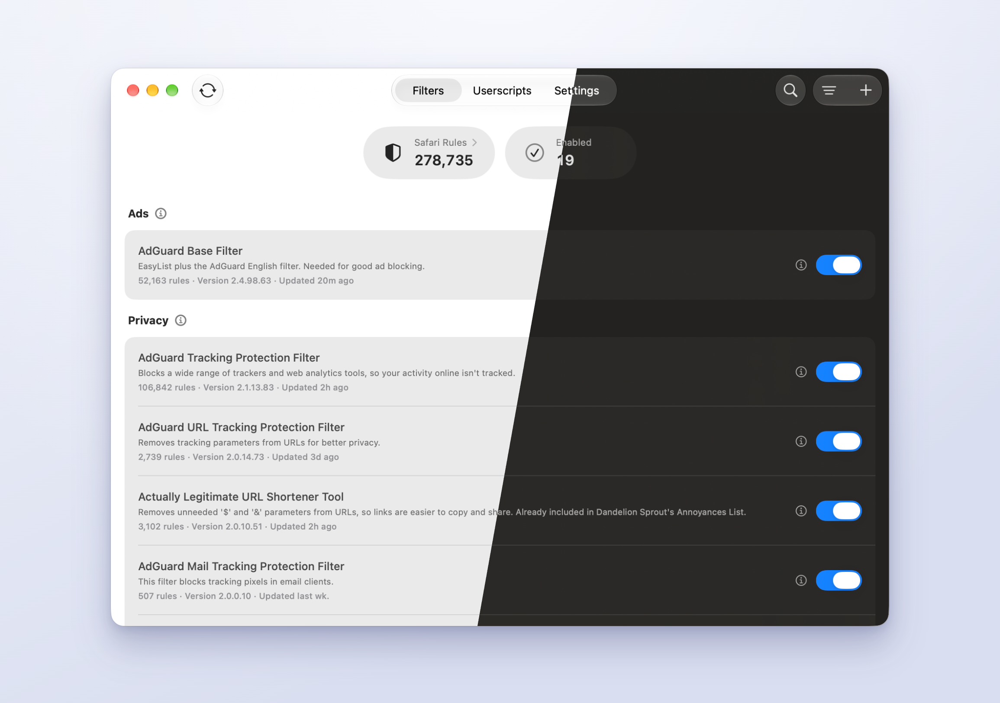
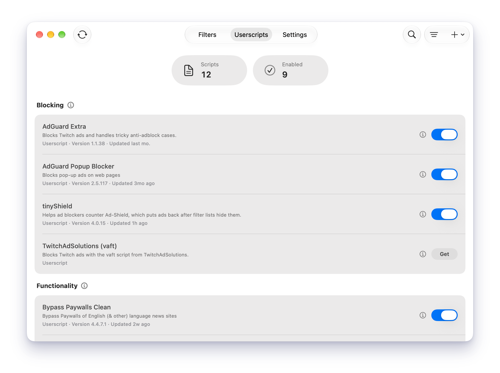
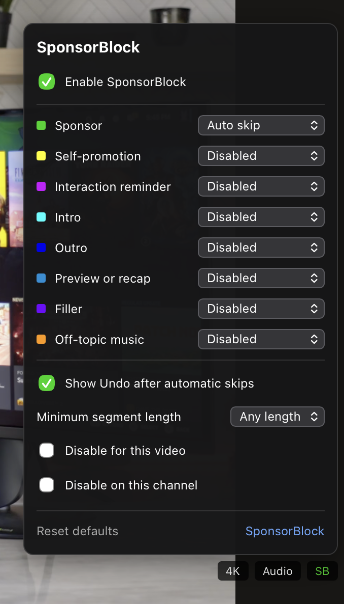
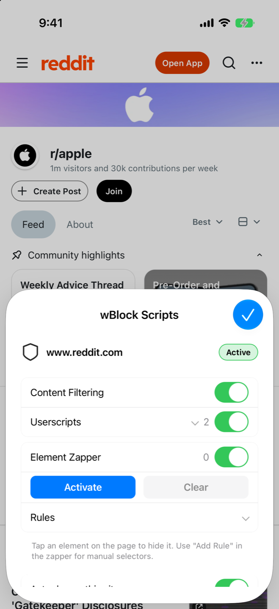
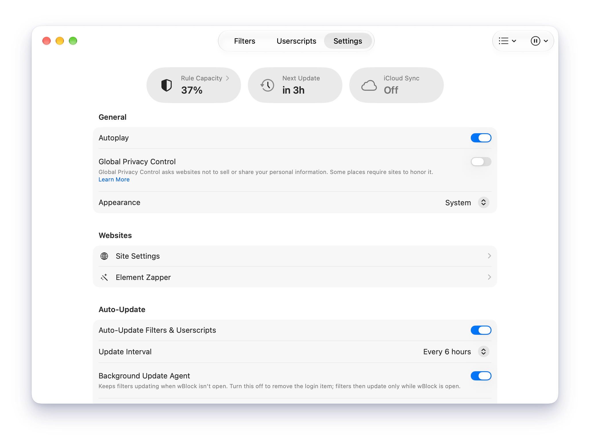

# wBlock

**The end of Safari ad-blocking B.S.**

A free, open-source ad blocker for Safari on Mac, iPhone, iPad, and Apple Vision Pro.

 

<a href="https://apps.apple.com/us/app/wblock/id6746388723?itscg=30200&itsct=apps_box_badge&mttnsubad=6746388723">
  <picture>
    <source media="(prefers-color-scheme: dark)" srcset="https://toolbox.marketingtools.apple.com/api/v2/badges/download-on-the-app-store/white/en-us?releaseDate=1760313600" width="220" />
    <source media="(prefers-color-scheme: light)" srcset="https://toolbox.marketingtools.apple.com/api/v2/badges/download-on-the-app-store/black/en-us?releaseDate=1760313600" width="220" />
    
  </picture>
</a>

 
 

 

 

wBlock is a free, open-source Safari content blocker for macOS, iOS, iPadOS, and visionOS. Five content blocking extensions provide a combined capacity of 750,000 rules, with a limit of 150,000 per extension. A separate scripts extension supports scriptlets, cosmetic filtering, userscripts, userstyles, element hiding, and native video controls.

wBlock does not collect user data. The rules viewer provides access to compiled rules, unsupported filter entries, and changes from the latest filter update.

> [!TIP]
> The [comparison guide](Adblock_Comparison.md) covers wBlock, uBlock Origin Lite, Wipr, and AdGuard.

 

## Features

### Content blocking

- AdGuard-compatible filter lists compiled into Safari's native rules and distributed across five content blockers. Safari applies the rules outside the app process; wBlock uses approximately 40 MB of memory at idle.
- Recommended default lists, automatic regional filter selection, and optional annoyance and cookie-banner filters. Custom lists can be added by URL, pasted text, or file import.
- Scheduled updates from hourly to weekly, with incremental downloads for lists that support them. A macOS launch agent checks for updates while the app is closed.
- Tracking-parameter removal, including `utm_*`, and link-shortener resolution. Both are enabled by default.
- A capacity indicator and rules viewer showing unsupported entries, duplicate rules, and rules handled by the scripts extension.

### Userscripts and userstyles

- A Greasemonkey-compatible engine supporting `GM_*` and `GM.*` APIs. `GM_xmlhttpRequest` is restricted to hosts declared in a script's `@connect` metadata.
- UserCSS themes (`.user.css`) with Less, Sass, and Stylus support. See [docs/USERSTYLES.md](docs/USERSTYLES.md).
- A built-in catalog containing Tube Cleaner, Player Cleaner, DeArrow, Dark Reader, Return YouTube Dislike, Bypass Paywalls Clean, AdGuard Extra, AdGuard Popup Blocker, and TwitchAdSolutions. Catalog scripts are disabled by default except tinyShield, which handles anti-adblock checks.

### Native video controls

Tube Cleaner and Player Cleaner enable Safari's native controls on existing video elements before the page renders. Supported features include Picture-in-Picture, background audio, fullscreen playback, and Now Playing integration.

Tube Cleaner supports YouTube while preserving its original video stream. It integrates chapters and captions into Safari's native menus and provides SponsorBlock skipping with per-category settings. DeArrow is available separately for alternative titles and thumbnails.

Player Cleaner supports video.js, JW Player, Plyr, Flowplayer, MediaElement, Clappr, Media Chrome, and shadow-root players such as Archive.org's. Playback speed, volume, captions, and playback position are saved per site.

Both scripts receive updates from [wBlock-userscripts](https://github.com/0xCUB3/wBlock-userscripts) independently of app releases. Ad blocking remains the responsibility of the filter lists.

### Per-site configuration

The Safari toolbar popup provides separate controls for filtering, userscripts, and autoplay, along with the element zapper. Filter lists and userscripts can be restricted to selected sites or excluded from specific domains. Zapper rules can be edited in Settings.

### Platform support and sync

wBlock supports macOS, iOS, iPadOS, and visionOS. iCloud sync includes filter lists, custom filters, userscripts, the allowlist, and settings. Local backup export is also available.

 

## Screenshots

<table>
<tr>
<td colspan="2" align="center">
  <picture>
    <source media="(prefers-color-scheme: dark)" srcset="docs/media/img/userscripts_macos_dark.png" />
    
  </picture>
   Userscripts on macOS
</td>
</tr>
<tr>
<td align="center" width="50%">
  
   SponsorBlock in Tube Cleaner
</td>
<td align="center" width="50%">
  <picture>
    <source media="(prefers-color-scheme: dark)" srcset="docs/media/img/scripts_popup_ios_dark.png" />
    
  </picture>
   The Safari popup on iPhone
</td>
</tr>
<tr>
<td colspan="2" align="center">
  <picture>
    <source media="(prefers-color-scheme: dark)" srcset="docs/media/img/settings_macos_dark.png" />
    
  </picture>
   Settings on macOS
</td>
</tr>
</table>

 

## Installation

- [App Store](https://apps.apple.com/us/app/wblock/id6746388723): supports automatic app updates.
- Homebrew: `brew tap 0xcub3/wblock && brew install --cask wblock`
- DMG: available from the [latest release](https://github.com/0xCUB3/wBlock/releases/latest).

The initial setup provides instructions for enabling the extensions in Safari.

 

## Technical implementation

The app downloads filter lists and converts them with [SafariConverterLib](https://github.com/AdguardTeam/SafariConverterLib) 4.3.0. Rules are distributed across five content blockers: Ads, Privacy, Security, Foreign, and Custom. Safari compiles and applies these rules independently of the app. The wBlock Scripts extension handles functionality that cannot be expressed through static rules.

Filter data is stored in Protocol Buffers with LZ4 compression. Streaming writes limit peak memory usage during compilation. Changes to a filter list rebuild only the affected content blockers. Safari must reload the updated rule sets before changes take effect.

The [comparison guide](Adblock_Comparison.md#how-wblock-works-around-static-rules) includes the rule used to disable filtering for a specific site.

 

## FAQ

Should wBlock be used alongside another ad blocker?

 

No. Use one general-purpose content blocker at a time.

Multiple blockers can make conflicting changes to the same page or request. Mozilla's [webRequest documentation](https://developer.mozilla.org/en-US/docs/Mozilla/Add-ons/WebExtensions/API/webRequest/onHeadersReceived) describes how conflicting response modifications may allow only one extension's change to succeed. The [uBlock Origin documentation](https://github.com/gorhill/ublock#all-programs) advises against using another content blocker alongside it. [AdGuard's guidance](https://adguard.com/en/adguard-browser-extension/opera/overview.html) identifies slower loading, broken sites, and video-playback problems as possible consequences.

Disable other ad blockers before reporting a wBlock issue. This allows the cause of a blocking failure or site compatibility problem to be isolated.

Should additional filter lists be enabled?

 

The recommended defaults cover most ads and trackers. Additional general-purpose lists often duplicate existing rules, consume Safari's rule capacity, and increase the risk of site compatibility problems. Annoyance lists provide coverage for cookie banners, popups, and social widgets. Regional lists provide additional coverage for non-English sites.

Does wBlock slow down Safari?

 

Not in normal use. Safari applies compiled rules outside the wBlock app process, so page loading does not wait for the app. Idle memory usage is approximately 40 MB.

How can Twitch ads be blocked?

 

Enable TwitchAdSolutions (vaft) or AdGuard Extra in the Userscripts tab, then reload Twitch. TwitchAdSolutions is the dedicated option. Use only one of these scripts at a time. Twitch frequently changes its ad delivery, so blocking may be temporarily affected until the script is updated.

Why are cookie-banner filters or scriptlets not working in Private Browsing?

 

Safari requires explicit permission for extensions to run in Private Browsing. Most cookie-banner filters rely on scriptlets provided by wBlock Scripts. In Safari → Settings → Extensions, enable Allow in Private Browsing for wBlock Scripts and all five content blockers, then reload the private window.

A stored consent cookie may explain why a banner is absent in a normal window. Clear the site's cookies before comparing normal and private browsing behavior.

How are userscript network requests handled?

 

`GM_xmlhttpRequest` requires `@grant GM_xmlhttpRequest` or `@grant GM.xmlHttpRequest`. Requests are restricted to hosts declared in the script's `@connect` metadata. A bare host permits that host and its subdomains; `localhost`, `self`, and `*` are also supported. Without `@connect`, requests are limited to the current host. Per-domain permission prompts are not currently available.

Only HTTP and HTTPS are supported. Redirect destinations are checked before the request follows them. If Safari does not expose a redirect destination to the extension, the request fails rather than bypassing the host restrictions. Requests do not include browser cookies or saved credentials. Requests marked `anonymous` also exclude cookies supplied by the script.

Where are Tube Cleaner and Player Cleaner located?

 

Both scripts are listed at the top of the General section in the Userscripts tab and are disabled by default. After enabling a script, individual features such as chapters, captions, and SponsorBlock can be configured separately. Player Cleaner can be disabled for a specific site through the Safari toolbar popup if compatibility issues occur.

How often do filters update, and must wBlock remain open?

 

Updates can be scheduled from hourly to weekly or performed manually. The app does not need to remain open. On macOS, a launch agent checks for updates while the app is closed; this behavior can be disabled in Settings.

On iOS and iPadOS, background updates are scheduled by the operating system. Disabling Background App Refresh or force-quitting wBlock from the app switcher may reduce update frequency or delay updates until the app is opened.

 

## Support

wBlock is free and open source. Optional contributions to development are accepted through Open Collective.

Report bugs and request features through [Issues](https://github.com/0xCUB3/wBlock/issues). Community support is available on [Discord](https://discord.gg/Y3yTFPpbXr). See the [privacy policy](PRIVACY_POLICY.md) for details on data handling.

 

## Credits

Contributors include [@arjpar](https://github.com/arjpar), [@ameshkov](https://github.com/ameshkov), and [@shindgew](https://github.com/shindgew). Rule conversion and scriptlets are provided by [AdGuard](https://github.com/AdguardTeam). SponsorBlock and DeArrow data are provided by [Ajay Ramachandran's](https://sponsor.ajay.app/) projects under CC BY-NC-SA 4.0.

 

<a href="https://www.star-history.com/?repos=0xCUB3%2FwBlock&type=date&legend=top-left">
 <picture>
   <source media="(prefers-color-scheme: dark)" srcset="https://api.star-history.com/chart?repos=0xCUB3/wBlock&type=date&theme=dark&legend=top-left&sealed_token=FHF3tvPu6mhBn3K4_1fpH1nj2W36bTa6aW6_u-990mCb5zN_PRort245hoHzQEhFBRJo38qUYoOzU1huHG4_mHDsYpO7YxzKOIJEUaQI4NQNRDSdt9aZ_T1PVVSIaXqpdYnrBTTIlKhCEkYdneNsXEnpXhiUB3GW2F-tnsMNC4DPQJUKAmJK90omDnb2" />
   
 </picture>
</a>

